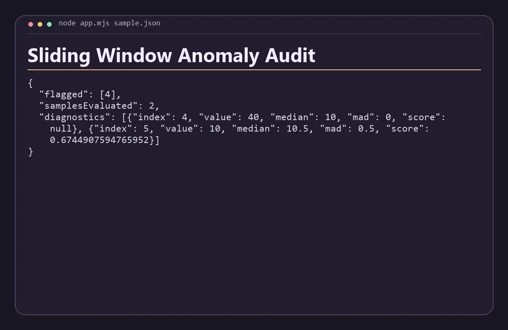

# Sliding Window Anomaly Audit

Flag time-series departures with an earlier rolling median, median absolute deviation and an explicit noise floor.



## Run

Install Node.js 22 or newer. Run these commands from the repository root.

```sh
node app.mjs sample.json
```

Replace `sample.json` with a JSON file following the same structure. The app prints a JSON report to standard output.

Each point is compared with the immediately preceding window. When the median absolute deviation is zero, a departure greater than minDelta is flagged. The standardized score is null in that case.

## Verify

Run `python check.py` with Python 3.11 or newer after the build step when applicable. The check verifies the bundled scenario and confirms that an invalid input returns an error.
